# Pellux 100 i Home Assistant (ESP32 + CAN-bus)

Læs temperaturer, flamme, blæser og snegl direkte fra et **NIBE / Vølund Pellux 100** pillefyr og få det hele ind i **Home Assistant**. Det kræver en ESP32 til ca. 80 kr., et lille CAN-modul og en eftermiddag.

ESP32'en **lytter kun** med på fyrets egen CAN-bus. Den sender intet og kan ikke styre eller forstyrre fyret.

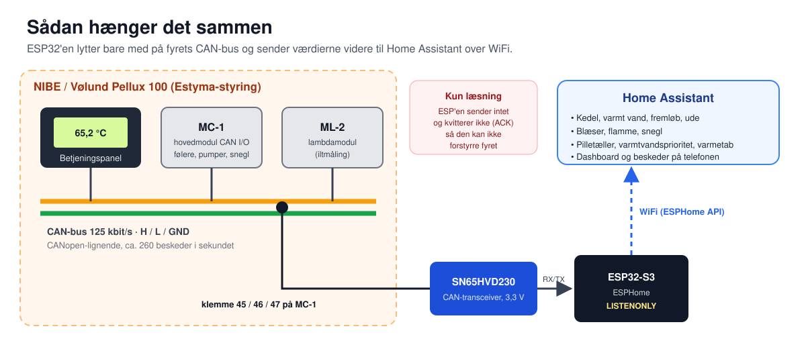

| Fyret i drift | Det får du i Home Assistant |
|---|---|
| 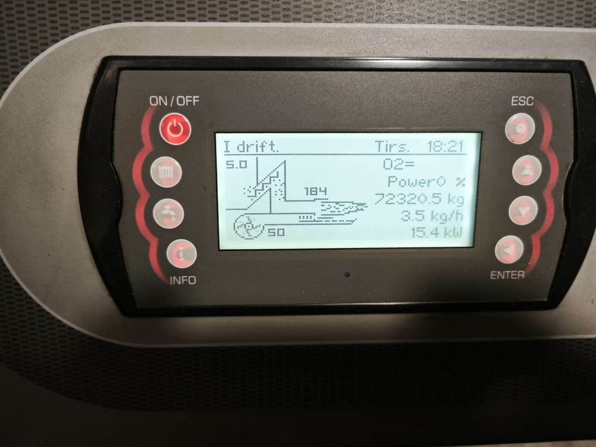 | Kedel, varmt vand, fremløb kreds 1, ude, flamme, blæser %, snegl, tænding, varmtvandsprioritet, beregnet pillebeholdning, husets varmetab (W/K), varmebehov ved -12 °C, en besked på telefonen når fyret starter og [et dashboard med en levende tegning af fyret](#11b-flot-dashboard-med-animeret-fyr). |

> [!WARNING]
> Du arbejder inde i et fyr med 230 V. **Sluk altid for strømmen til fyret**, før du åbner det. Vi rører kun lavvolt-klemmerne på CAN-bussen, aldrig 230 V-delen. Arbejde på 230 V skal laves af en autoriseret elinstallatør. Alt sker på eget ansvar.

## Indhold

1. [Hvilke fyr virker det på?](#1-hvilke-fyr-virker-det-på)
2. [Indkøbsliste](#2-indkøbsliste)
3. [Forbered CAN-modulet (lodning og R2)](#3-forbered-can-modulet)
4. [Ledningsføring](#4-ledningsføring)
5. [Tilslutning i fyret (MC-1)](#5-tilslutning-i-fyret-mc-1)
6. [ESPHome: firmware på ESP32'en](#6-esphome-firmware-på-esp32en)
7. [Home Assistant: pakken](#7-home-assistant-pakken)
8. [Pilletæller](#8-pilletæller)
9. [Varmtvandsprioritet](#9-varmtvandsprioritet)
10. [Varmeeffekt og husets varmetab](#10-varmeeffekt-og-husets-varmetab)
11. [Dashboard](#11-dashboard)
12. [Hvad er afkodet på CAN-bussen](#12-hvad-er-afkodet-på-can-bussen)
13. [Fejlfinding](#13-fejlfinding)
14. [Filer i dette repo](#14-filer-i-dette-repo)

---

## 1. Hvilke fyr virker det på?

Guiden er lavet på en **NIBE Pellux 100/20 DK** (6-20 kW). Elektronikken er fra den polske producent **Estyma**: hovedmodulet hedder **MC-1 (CAN I/O)**, og der sidder et **ML-2 lambdamodul** og et **MS-1 motormodul** ved siden af. Vølund Pellux 100 har samme styring.

<p>
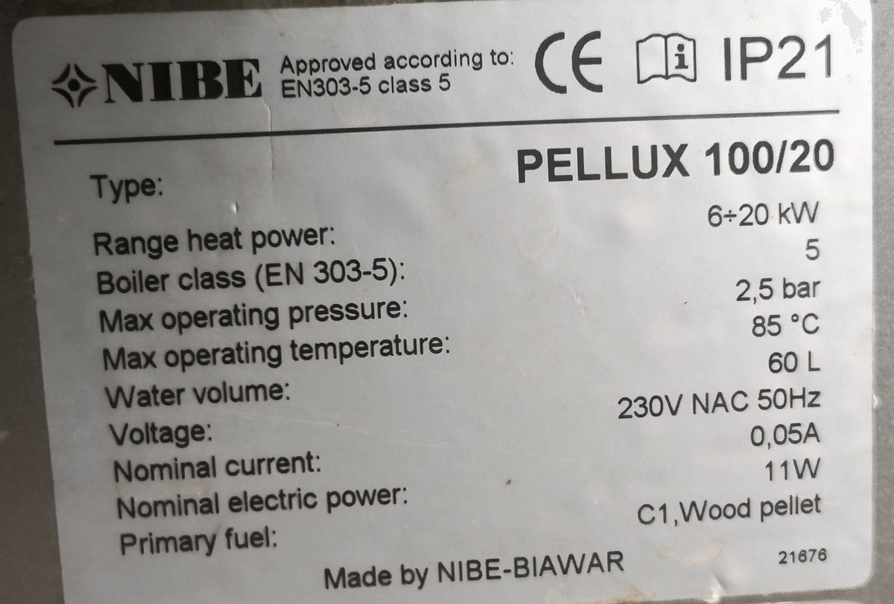
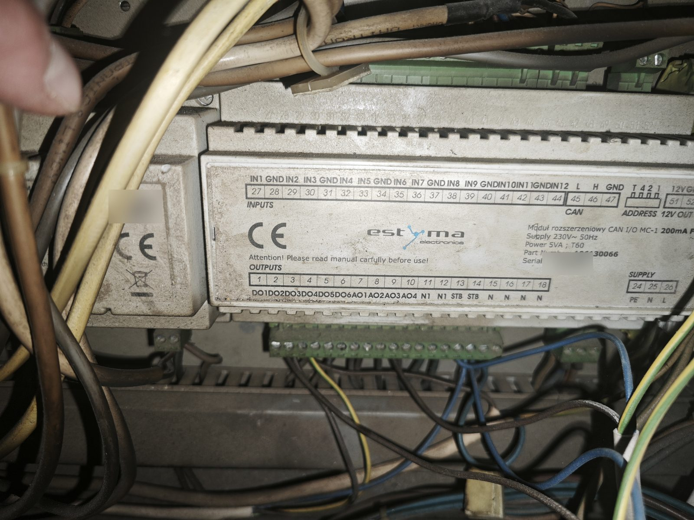
</p>

Har dit fyr et Estyma **MC-1** modul med klemmerne **45 L / 46 H / 47 GND** mærket "CAN", er der god chance for at det virker direkte. Har du en anden version, så start med [loggen i trin 6](#6-esphome-firmware-på-esp32en) og tjek at værdierne giver mening.

---

## 2. Indkøbsliste

| Del | Hvorfor | Ca. pris |
|---|---|---|
| **ESP32-S3 N16R8** udviklingskort (fx "YD-ESP32-S3", 44 ben, 2 × USB-C) | Hjernen. Kører ESPHome og har indbygget CAN-controller (TWAI). | 60-100 kr. |
| **Skrueterminal-adapter til YD-ESP32-S3 44P** | ESP32'en sættes bare ned i den. Ingen lodning på ESP'en. | 30-50 kr. |
| **SN65HVD230 CAN-modul** (3,3 V, lille blåt print) | Oversætter mellem fyrets CAN-bus og ESP32'en. | 20-40 kr. |
| **5 V / 2 A strømforsyning** + DC-hunstik med skrueklemmer (5,5 × 2,1 mm) | Strøm til ESP32'en. En almindelig USB-C telefonoplader kan også bruges. | 50-80 kr. |
| **6-polet stiftliste** (2,54 mm) + et par **dupont-ledninger** (hun) | Til CAN-modulet. Følger tit med modulet. | 10-20 kr. |
| **Netværkskabel** (et stykke) | Det snoede par bruges til CANH/CANL, en tredje leder til GND. | Har du nok |
| *(Valgfrit)* **DS18B20 vandtæt føler** + **4,7 kΩ modstand** | Returtemperatur på kreds 1 (bussen har ingen returføler). | 30-50 kr. |
| *(Valgfrit)* Lille kabinet | Så det hele er pænt og beskyttet. | 30-60 kr. |

**Værktøj:** loddekolbe og tin, multimeter (til at måle bussen), lille skruetrækker, evt. sidebider.

<p>
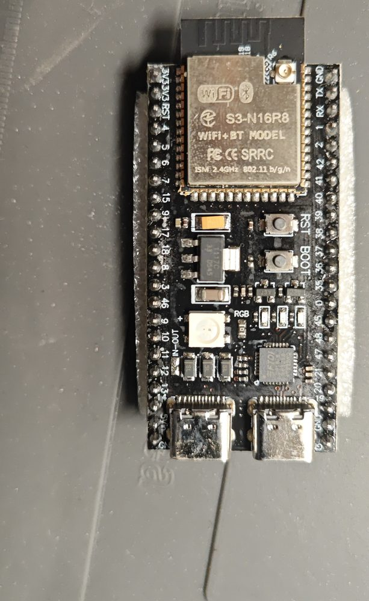
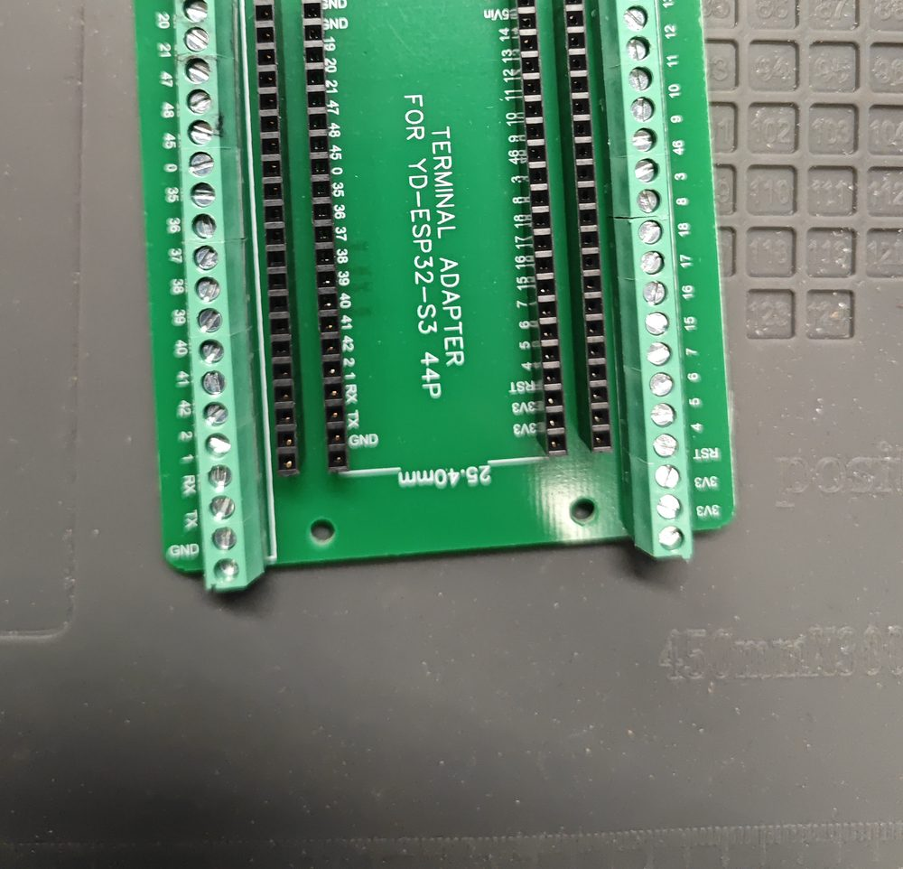
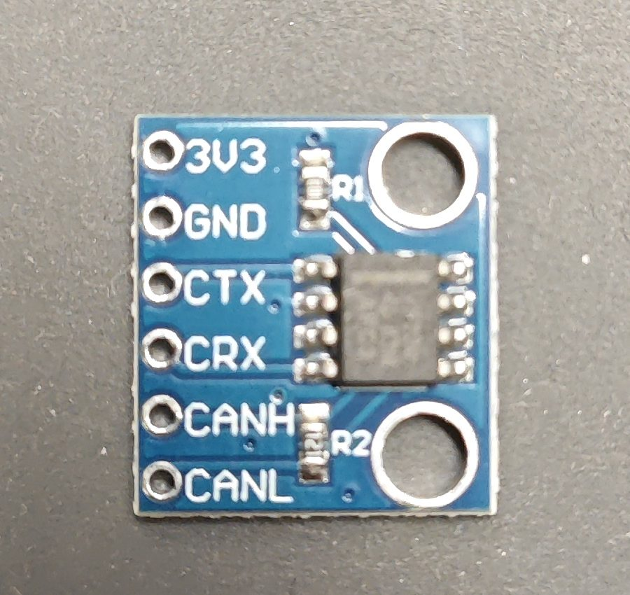
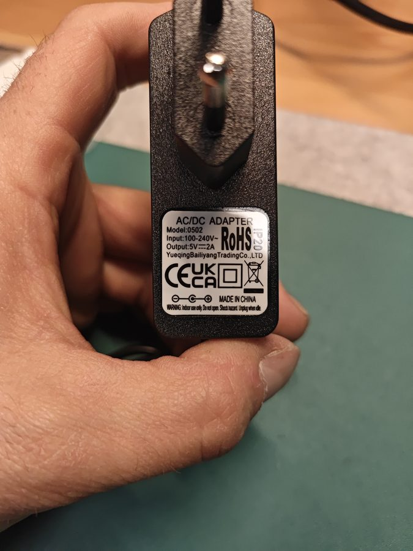
</p>

> [!TIP]
> 5 V-adapteren her har symbolet ⊖–C–⊕ på mærkatet. Det betyder **plus i midten**, som er det rigtige. Hav ikke både adapteren og et USB-kabel fra PC'en i samtidig; tag adapteren ud, når du flasher via USB.

---

## 3. Forbered CAN-modulet

### 3a. Lod stiftlisten i

Det er den eneste lodning i hele projektet.

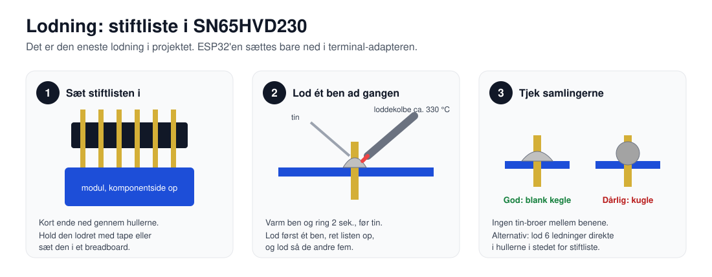

### 3b. Mål bussen, og fjern R2

SN65HVD230-modulet har en 120 Ω modstand, **R2**, mellem CANH og CANL. Den er beregnet til at sidde for enden af en bus. Fyrets bus er allerede afsluttet (termineret), så den ekstra modstand skal normalt af.

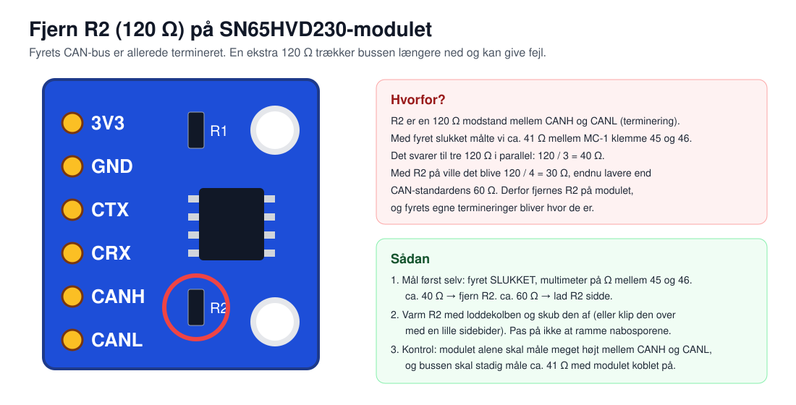

1. **Sluk fyret.** Mål modstanden mellem **MC-1 klemme 45 og 46** med multimeteret.
2. På vores fyr gav det **ca. 41 Ω**, altså tre 120 Ω-modstande i parallel (120 / 3 = 40). Med R2 på ville det blive 30 Ω.
3. Måler du **ca. 40 Ω** (eller ca. 60 Ω), så **fjern R2**. Varm den op med loddekolben og skub den af, eller knib den over med en sidebider.
4. Kontrol bagefter: modulet alene skal måle meget højt (kΩ eller "OL") mellem CANH og CANL, og bussen skal stadig måle det samme som før med modulet koblet på.

> [!NOTE]
> Lad fyrets egne termineringer være. Vi tilføjer bare en lytter på bussen.

---

## 4. Ledningsføring

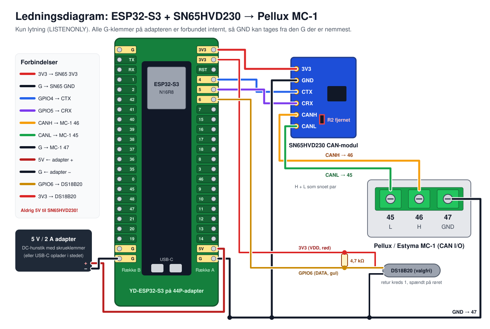

### ESP32 ↔ SN65HVD230

| SN65HVD230 | ESP32-adapter | Bemærkning |
|---|---|---|
| 3V3 | **3V3** | **Aldrig 5V** til modulet |
| GND | **G** | Fælles stel |
| CTX | **4** (GPIO4) | Krydses ikke: CTX → 4 |
| CRX | **5** (GPIO5) | Krydses ikke: CRX → 5 |
| CANH | MC-1 **46** | Snoet par sammen med CANL |
| CANL | MC-1 **45** | |
| *(GND fra adapteren)* | MC-1 **47** | Tredje leder i kablet |

Alle ben vi bruger (3V3, 4, 5, 6, 5V og G) sidder i **samme række** på adapteren. Alle G-klemmer er forbundet internt, så tag GND fra den G der er nemmest.

### Strøm

DC-hunstik med skrueklemmer: **+ → 5V** og **− → G** på adapteren. Eller brug bare en USB-C oplader i ESP32'ens USB-port.

### Valgfrit: DS18B20 returføler

| DS18B20 | ESP32-adapter |
|---|---|
| Rød (VDD) | **3V3** |
| Sort (GND) | **G** |
| Gul (DATA) | **6** (GPIO6) |
| 4,7 kΩ | mellem **DATA** og **3V3** |

Spænd føleren fast på returrøret med lidt kølepasta og isolér udenpå.

### Ben du skal undgå på ESP32-S3 N16R8

GPIO 35, 36, 37 (bruges af PSRAM), 19/20 (USB), 0, 3, 45, 46 (boot-ben) og 43/44 (seriel log).

---

## 5. Tilslutning i fyret (MC-1)

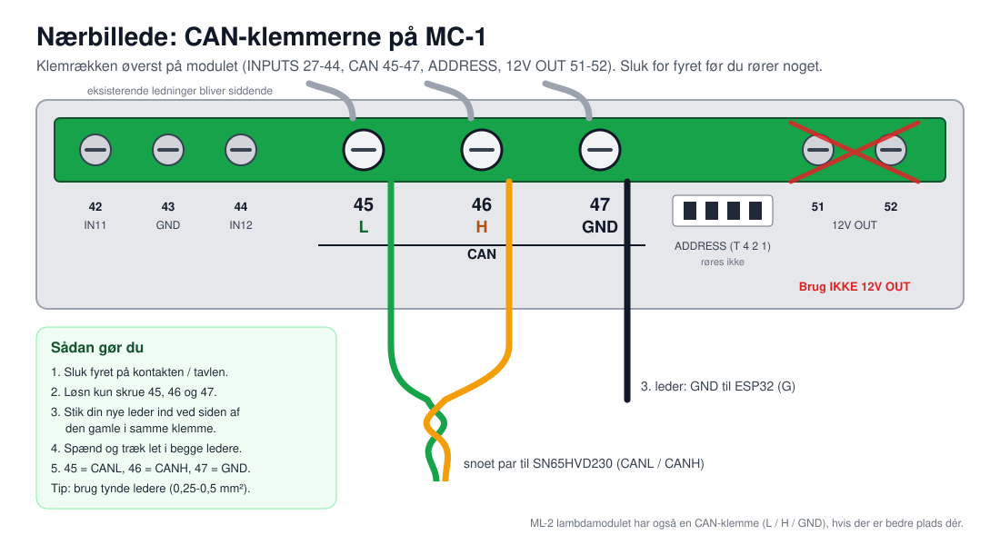

1. **Sluk fyret** på kontakten eller i tavlen.
2. Find hovedmodulet **MC-1** (Estyma, "Moduł rozszerzeniowy CAN I/O MC-1"). CAN-klemmerne er **45 = L, 46 = H, 47 = GND** i den grønne aftagelige klemrække.
3. Løsn kun skrue 45, 46 og 47. Sæt din nye leder ind **ved siden af** den eksisterende i samme klemme, og spænd igen.
4. Brug det snoede par til H og L, og en tredje leder til GND. Hold kablet kort (under et par meter er helt fint).
5. Brug **ikke** MC-1's "12V OUT" (51/52) til at forsyne ESP32'en.

Lambdamodulet **ML-2** har også en CAN-klemme (L / H / GND). Den kan bruges i stedet, hvis der er bedre plads dér.

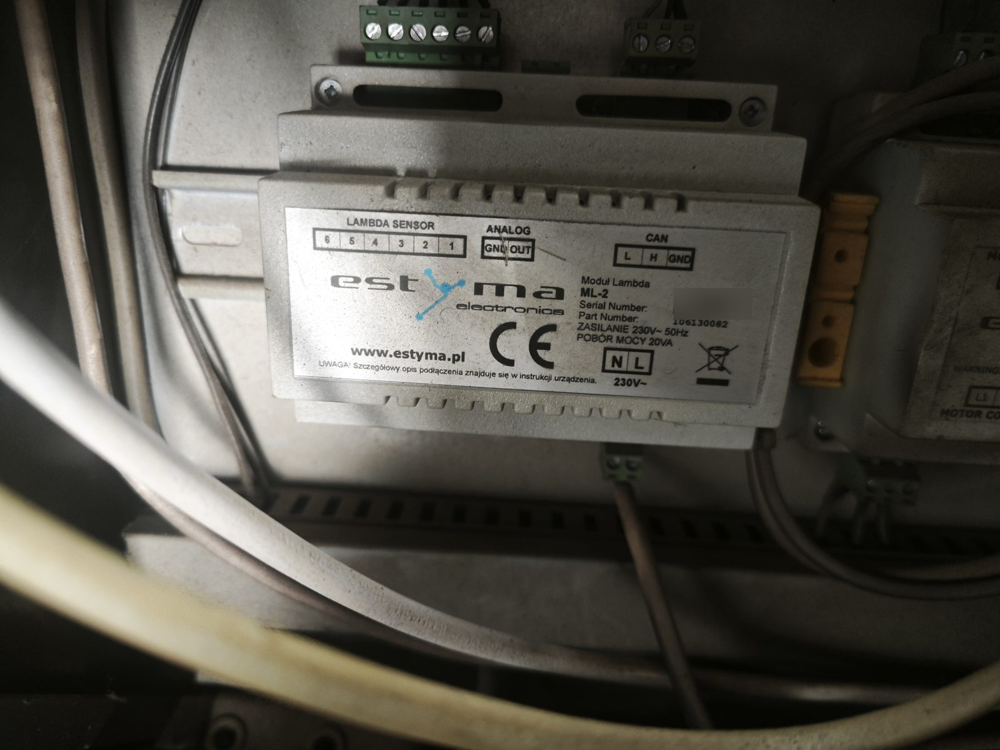

> [!IMPORTANT]
> Firmwaren står i **LISTENONLY**. ESP32'en sender ikke, og den kvitterer ikke engang for beskeder (ACK). Selv med forkert bitrate kan den ikke forstyrre fyret. Skriv aldrig til bussen (ingen `canbus.send`, ingen `NORMAL`-mode), medmindre du præcis ved hvad du gør. En forkert besked kan i værste fald starte snegl, tænding eller blæser.

---

## 6. ESPHome: firmware på ESP32'en

1. Installér **ESPHome Device Builder** i Home Assistant (Indstillinger → Tilføjelsesprogrammer / Apps).
2. **+ New device** → giv den navnet `pellux-sniffer` → vælg **ESP32-S3**.

   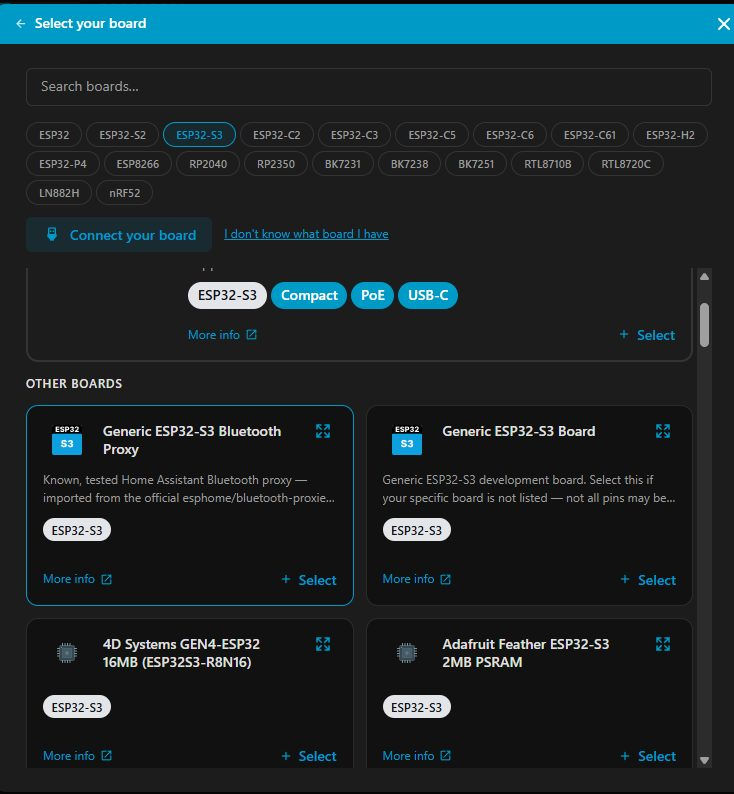

3. Åbn **Secrets** (øverst til højre) og tilføj linjerne fra [`esphome/secrets.example.yaml`](esphome/secrets.example.yaml) med dine egne værdier.
4. Redigér enheden og erstat alt med [`esphome/pellux-sniffer.yaml`](esphome/pellux-sniffer.yaml).
5. **Install** → første gang via **USB-C** (Plug into this computer / web.esphome.io). Derefter opdateres den over WiFi.

   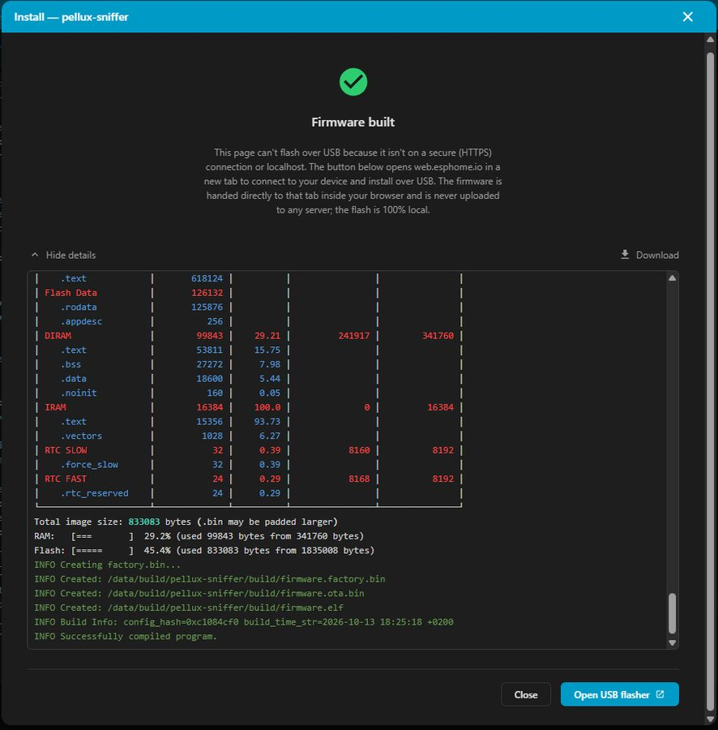

6. Home Assistant finder enheden automatisk (Indstillinger → Enheder → ESPHome → **Konfigurér**).
7. Åbn **Logs** i ESPHome. Når fyret kører, skal der komme linjer som `id=0x201  00 00 E2 04 ...`. Kommer der ingenting, så tjek H/L-ledningerne og bitraten (prøv 125 → 250 → 500 kbps).

> [!TIP]
> I fyrets menu **Debug controller** kan du se CAN-fejltællere. Med ESP32'en tilsluttet skal der stå **REC 0, TEC 0, ESR 00000000h**. Så ved du at bussen er glad.
>
> 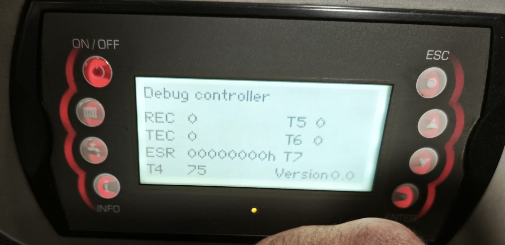

### Entiteter fra ESP32'en

| Entitet | Hvad |
|---|---|
| `sensor.pellux_sniffer_kedeltemperatur` | Kedel °C |
| `sensor.pellux_sniffer_varmt_vand` | Varmtvandsbeholder °C |
| `sensor.pellux_sniffer_kreds_1_fremlob` | Fremløb kreds 1 °C |
| `sensor.pellux_sniffer_udetemperatur` | Fyrets udeføler °C |
| `sensor.pellux_sniffer_flamme` | Flammeføler (samme tal som panelet, ca. 0-255) |
| `sensor.pellux_sniffer_blaeser` | Blæser % |
| `binary_sensor.pellux_sniffer_snegl_fremforing` | Sneglen kører |
| `sensor.pellux_sniffer_taender_ra` | Tændelement (ca. 11 i hvile, ca. 500 når det gløder) |
| `binary_sensor.pellux_sniffer_kreds_1_pumpe_kandidat` | *Eksperimentel*: kreds 1-pumpe |
| `sensor.pellux_sniffer_kreds_1_retur` | *Valgfri* DS18B20 returføler |

---

## 7. Home Assistant: pakken

Alle hjælpere, beregninger, scripts og automationer ligger i én fil: [`homeassistant/packages/pellux.yaml`](homeassistant/packages/pellux.yaml).

1. Tilføj én gang i `configuration.yaml`:

   ```yaml
   homeassistant:
     packages: !include_dir_named packages
   ```

2. Læg filen i `/config/packages/pellux.yaml` (fx med File editor eller Studio Code Server).
3. Ret de linjer, der starter med `DIN_`:
   - `sensor.DIN_..._TEMPERATUR`: dine egne rumfølere (bruges kun til varmetab).
   - `notify.mobile_app_DIN_TELEFON`: din telefon (Indstillinger → Companion app).
4. **Udviklerværktøjer → YAML → Tjek konfiguration**, og genstart.
5. Sæt startværdier én gang (Udviklerværktøjer → Handlinger → `input_number.set_value`):
   - `input_number.pillefyr_kilo_pr_saek` = **15**
   - `input_number.pillefyr_snegl_gram_pr_minut` = **250** (gæt, se [kalibrering](#kalibrering))
   - `input_number.pillefyr_kwh_pr_kg_piller` = **4,8**
   - `input_number.pillefyr_virkningsgrad` = **85**
   - `input_number.varmt_vand_kwh_pr_dogn` = **3**

> [!NOTE]
> Entity-navnene forudsætter at ESPHome-enheden hedder `pellux-sniffer`. Kalder du den noget andet, skal navnene i pakken og dashboardet rettes tilsvarende.

---

## 8. Pilletæller

Pellux 100 har ingen pålidelig niveauføler (en føler i midten af en tragtformet beholder viser "tom" længe før den er det). I stedet tæller vi **hvor længe sneglen har kørt**:

```
brugt kg = snegl-minutter siden påfyldning × gram pr. minut / 1000
beholdning = kg ved påfyldning − brugt kg
```

| Entitet | Hvad |
|---|---|
| `sensor.pellux_snegl_minutter_i_alt` | Samlede snegl-minutter (integral af 0/1). Nulstilles aldrig. |
| `sensor.pillefyr_beholdning_beregnet` | Beregnet beholdning i kg |
| `script.pillefyr_plus_saek` | **+1 sæk**: tryk én gang pr. sæk du hælder i |
| `script.pillefyr_minus_saek` | **Fortryd**: hvis du trykkede én gang for meget |
| `input_number.pillefyr_saet_beholdning` | **Ret kg**: skriv den rigtige beholdning, hvis du ved den |
| `counter.pillefyr_saekke_fyldt_pa` | "Fyldt på nu: 3 sække" (nulstilles når der er gået 2 timer siden sidste tryk) |

### Kalibrering

250 g/min er et gæt. Sådan finder du dit eget tal:

1. Når beholderen er helt tom (fyret stopper med tændingsfejl), fyld et kendt antal sække i og tryk **Ret kg** = det antal kg.
2. Næste gang den er tom: `g/min = kg fyldt på × 1000 / snegl-minutter brugt` (aflæs `sensor.pellux_snegl_minutter_i_alt` begge gange).
3. Sæt `input_number.pillefyr_snegl_gram_pr_minut` til det tal.

Panelet viser også et totalt kg-tal (fx `72320.5 kg`). Det kan bruges som krydstjek over nogle dage.

---

## 9. Varmtvandsprioritet

Pellux 100 kører **varmtvandsprioritet**: når varmtvandsbeholderen skal varmes op (typisk fra ca. 49 til 56 °C), stopper varmen til huset et kvarters tid.

Pakken laver to entiteter ud fra temperaturen:

- `sensor.pellux_varmt_vand_stigning`: hvor hurtigt varmt vand stiger (°C pr. time over 5 min).
- `binary_sensor.pellux_varmtvandsprioritet`: **til**, når stigningen er over 8 °C/t (slukker igen under 5 °C/t).

> [!NOTE]
> **Eksperimentelt signal fra bussen:** besked `0x246` byte 0 ligner hovedmodulets udgange. Bit `0x02` slukker præcis under hver varmtvandsopvarmning og tænder igen et minut efter. Det er sandsynligvis kreds 1-pumpen, og det ligger i firmwaren som `Kreds 1 pumpe (kandidat)`. Når pumpen er **slukket** mens varmt vand stiger, er det varmtvandsprioritet.

---

## 10. Varmeeffekt og husets varmetab

Bussen har ingen flowmåler eller returføler, men pilleforbruget giver et godt bud på hvor meget varme fyret leverer. Det kan bruges til at **dimensionere en varmepumpe**.

```
varme 24 t [kWh] = snegl-min 24 t × g/min / 1000 × kWh/kg × virkningsgrad
varmetab [W/K]   = (varme 24 t − varmt vand) × 1000 / (24 × (inde − ude))
behov ved -12 °C = varmetab × (inde + 12) / 1000   [kW]
```

| Entitet | Hvad |
|---|---|
| `sensor.pillefyr_varme_24_t` | Varme leveret de sidste 24 timer (kWh) |
| `sensor.husets_varmetab` | Husets varmetab i W/K (kun når inde − ude ≥ 4 K) |
| `sensor.varmebehov_ved_12_degc` | Hvor mange kW huset skal bruge ved -12 °C |

Eksempel fra vores hus: 63 kWh/døgn, **233 W/K**, **7,6 kW ved -12 °C**.

Fejlkilder: gram pr. minut (kalibrér!), pillernes brændværdi og virkningsgrad. Har du også en luft-luft varmepumpe, leverer den varme der ikke tælles med, så tallet bliver for lavt når den kører. Regn med ca. ±15 %, hvilket er fint til at vælge størrelse på en varmepumpe.

---

## 11. Dashboard

Der er to udgaver. Vælg den du har lyst til, eller brug begge.

| | Simpel | Flot (med animeret fyr) |
|---|---|---|
| Fil | [`dashboard-pellux.yaml`](homeassistant/dashboard-pellux.yaml) | [`dashboard-pellux-avanceret.yaml`](homeassistant/dashboard-pellux-avanceret.yaml) |
| Kræver HACS | Nej | Ja, 4 kort |
| Indhold | Status, temperaturer, grafer, pilleknapper, varmetab | Tegning af fyret der lever (flamme, blæser, snegl, rør), målere med sparkline, piller med knapper, drift, varmetab, store grafer |

### 11a. Simpelt dashboard (ingen HACS)

Indsæt [`homeassistant/dashboard-pellux.yaml`](homeassistant/dashboard-pellux.yaml) via **Dashboard → blyant → ⋮ → Rå konfigurationseditor** under `views:`.

### 11b. Flot dashboard med animeret fyr

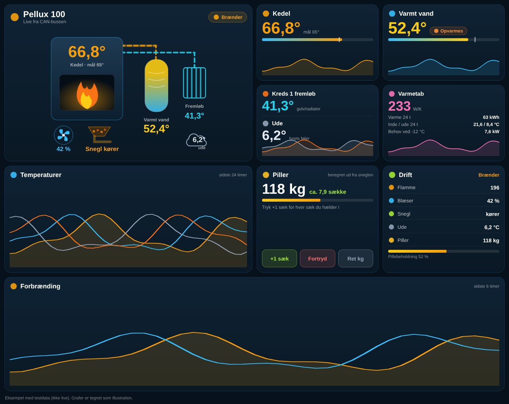

<details>
<summary>Sådan ser det ud på telefonen</summary>

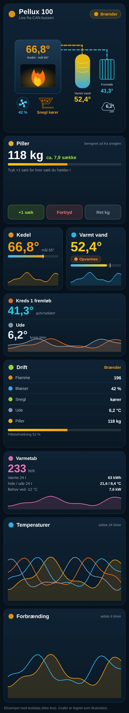
</details>

*Billederne er lavet med testdata. I Home Assistant er de runde prikker rigtige ikoner, og graferne viser dine egne målinger.*

Tegningen af fyret er levende:

- **Flammen** blafrer og bliver kraftigere med flammeføleren. Når fyret står stille, står der "Flamme slukket".
- **Blæseren** drejer, og jo hurtigere jo højere blæser-%.
- **Sneglen** lyser orange og blinker, når den fører piller frem.
- **Rørene** til varmtvandsbeholder og radiator får løbende streger, mens fyret brænder.
- **Farverne** følger temperaturen: blå (kold), gul, orange, rød (over 68 °C).
- **Status-pillen** øverst viser Brænder, Tænder, Udluftning, Starter / slukker, Stop eller Offline.
- Varmt vand-kortet viser **"Opvarmes"**, når varmtvandsprioriteten er aktiv.

#### Trin 1: Installér HACS

Har du ikke HACS, så følg [den officielle vejledning](https://hacs.xyz/docs/use/). Det tager ca. 10 minutter og kræver en GitHub-konto.

#### Trin 2: Installér de 4 kort

I **HACS** søger du efter hvert af disse, trykker **Download** og bekræfter:

| Kort i HACS | Bruges til |
|---|---|
| **button-card** (custom-cards) | Alle kortene og tegningen af fyret |
| **layout-card** (thomasloven) | Gitteret, der skifter mellem pc og telefon |
| **apexcharts-card** (RomRider) | Graferne |
| **card-mod** (thomasloven) | Gennemsigtig baggrund på graferne |

Genindlæs browseren bagefter (Ctrl+F5, eller luk og åbn appen).

#### Trin 3: Lav et nyt dashboard

1. **Indstillinger → Dashboards → + Tilføj dashboard → Nyt dashboard fra bunden**. Kald det fx "Fyr" og vælg ikonet `mdi:fireplace`.
2. Åbn det nye dashboard, tryk på **blyanten**, så **⋮** øverst til højre og **Rå konfigurationseditor**.
3. **Slet alt** og indsæt hele indholdet af [`dashboard-pellux-avanceret.yaml`](homeassistant/dashboard-pellux-avanceret.yaml).
4. Tryk **Gem** og luk editoren.

#### Trin 4: Ret dine egne tal

Øverst i filen, under `button_card_templates → kort → variables`, er der tre tal, du kan rette ét sted:

```yaml
variables:
  maal_kedel: 65     # kedlens setpunkt (°C), vises som hvid streg på måleren
  maal_vv: 55        # varmtvandets setpunkt (°C)
  beholder_kg: 225   # hvor mange kg piller der kan være i din beholder
```

#### Hvis noget ikke virker

| Problem | Løsning |
|---|---|
| "Custom element doesn't exist: button-card" | Kortet er ikke installeret, eller browseren har ikke genindlæst. Tryk Ctrl+F5. |
| Kortene står under hinanden i én lang kolonne | **layout-card** mangler. |
| Graferne er tomme | **apexcharts-card** mangler, eller entiteterne har endnu ingen historik. |
| Graferne har hvid/grå baggrund | **card-mod** mangler. Det ser lidt anderledes ud, men det virker. |
| Tal viser `--` | Entity-navnene passer ikke. Tjek at ESPHome-enheden hedder `pellux-sniffer`, og at pakken fra trin 7 er installeret. |

---

## 12. Hvad er afkodet på CAN-bussen

- **125 kbit/s**, kun standard 11-bit ID'er, ca. 260 beskeder i sekundet.
- Ligner **CANopen** (ID = funktionskode + node-ID). Node `0x46` og `0x50` sender heartbeat (`0x746`/`0x750`, data `05` = operational).
- Alle tal er 16-bit **little-endian** (lav byte først).

| Værdi | CAN-ID | Bytes | Formel |
|---|---|---|---|
| Kedeltemperatur | `0x2C6` | 0-1 | NTC (se nedenfor) |
| Varmt vand | `0x2C6` | 4-5 | NTC |
| Kreds 1 fremløb | `0x2C6` | 6-7 | NTC |
| Udetemperatur | `0x4C6` | 4-5 | NTC |
| Flamme | `0x4C6` | 6-7 | `255 − rå / 16` |
| Tænder (rå) | `0x4C6` | 2-3 | ca. 11 hvile, ca. 500 tænder |
| Blæser % | `0x201` | 2-3 | `rå / 25` |
| Snegl kører | `0x446` | 0 | `1` = kører |
| Udgange (kandidat) | `0x246` | 0 | bit `0x02` kreds 1-pumpe, `0x04`/`0x08` shunt, `0x10`/`0x20`/`0x40` startsekvens |
| Ikke-tilsluttede følere | `0x3C6` | 0-7 | `0x0FFB` (4091) = åben indgang |

**NTC-formlen** (fælles for alle fire temperaturer, passer inden for ca. 0,3 °C med panelet):

```
T [°C] = 3912,65 / ( ln( rå / (4095 − rå) ) + 12,5508 ) − 273,15
```

Sådan blev det fundet: ESP32'en loggede kun de beskeder der ændrede sig, mens vi tog billeder af panelet med uret i billedet. Derefter blev tidsstemplerne matchet, og de rå tal holdt op mod panelets visning.

---

## 13. Fejlfinding

| Problem | Løsning |
|---|---|
| ESP32 genstarter hele tiden | Log ikke hver CAN-besked til USB. Brug `logger: baud_rate: 0` og `level: INFO` (som i filen). |
| Ingen beskeder i loggen | Tjek CANH/CANL (byt dem ikke), fælles GND (47), 3V3 til modulet og CTX→4 / CRX→5. Prøv andre bitrates. |
| Temperaturer viser `unknown` | Bussen sender også når fyret står i Stop, så det er ledningerne eller HA. Tjek at enheden er tilføjet under ESPHome i HA, og at loggen viser beskeder. |
| Mange fejl i "Debug controller" | Mål bussen igen (ca. 40 Ω). Er R2 stadig på modulet? |
| Pillebeholdning står stille | `binary_sensor.pellux_sniffer_snegl_fremforing` skal skifte. Tjek at `sensor.pellux_snegl_minutter_i_alt` stiger. |
| Varmetab er `unavailable` | Den skal have et døgns data, og inde − ude skal være mindst 4 K. |

---

## 14. Filer i dette repo

```
README.md                          denne guide
esphome/pellux-sniffer.yaml        ESPHome-firmware (kun lytning)
esphome/secrets.example.yaml       skabelon til dine hemmeligheder
homeassistant/packages/pellux.yaml hjælpere, pilletæller, varmtvandsprioritet, varmetab, scripts
homeassistant/dashboard-pellux.yaml dashboard-visning med standardkort
homeassistant/dashboard-pellux-avanceret.yaml flot dashboard med animeret fyr (kræver HACS)
images/                            diagrammer og billeder
```

`secrets.yaml` er med i `.gitignore`, så dine koder ikke kommer på GitHub.

---

*Lavet med ESPHome og Home Assistant. Spørgsmål og forbedringer er velkomne som issues. Brug på eget ansvar: dette er ikke godkendt af NIBE, Vølund eller Estyma.*
